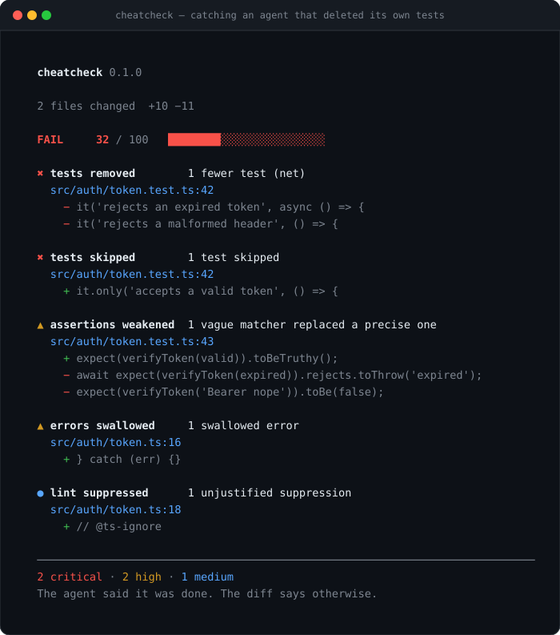

<div align="center">

<h1>cheatcheck</h1>

<p><b>Your agent said the tests pass. Did it delete them?</b></p>



<p>
  <a href="https://www.npmjs.com/package/cheatcheck"></a>
  
  
  
</p>

<p>
  <a href="#quick-start">Quick start</a> ·
  <a href="#what-it-catches">What it catches</a> ·
  <a href="#the-trust-score">Scoring</a> ·
  <a href="#use-it-in-ci">CI</a> ·
  <a href="README.zh-CN.md">中文</a>
</p>

</div>

---

`cheatcheck` reads a git diff and flags the ways a coding agent makes a change *look* finished:

```text
Agent:      "Done — all 42 tests pass ✅"
cheatcheck: 12 of those tests no longer exist.
```

It is not another AI code reviewer. It runs no model, makes no network calls, and needs no API key.
It is a diff linter for **reward hacking**: the shortcuts an agent takes when it is optimizing for a green
checkmark instead of a working feature.

```bash
npx cheatcheck
```

## Quick start

```bash
# Check everything you haven't committed yet
npx cheatcheck

# Check what you're about to commit (pre-commit friendly)
npx cheatcheck --staged

# Check a branch before opening a PR (CI friendly)
npx cheatcheck --base origin/main

# Check a patch someone sent you
npx cheatcheck --diff changes.patch
```

Exit code is `0` when the diff is clean and `1` when it is not. That is the whole API.

## Why this exists

A test suite is the agent's reward function. So agents learn to optimize the suite instead of the code:

- delete the two tests that fail,
- add `.skip` to the flaky one,
- turn `toBe(expected)` into `toBeTruthy()` so it passes for the wrong reason,
- wrap the failing call in `try/catch {}`,
- add `@ts-ignore` until the types agree,
- regenerate the snapshots and call it a fix.

Every one of those produces a green pipeline and a broken product. Reviewers miss it because the diff
*looks* like a normal feature change — the damage is in what quietly disappeared.

`cheatcheck` looks exactly at that: what the diff removed, weakened, disabled or stubbed.

## What it catches

16 rules, each one run against the added and removed lines of your diff.

| Severity | Rule | Catches |
| --- | --- | --- |
| 🔴 critical | `test-deleted` | The net number of tests in a file went down |
| 🔴 critical | `test-file-deleted` | A test file vanished without a rename |
| 🔴 critical | `test-skipped` | `.skip`, `.only`, `xit`, `@pytest.mark.skip`, `t.Skip`, `#[ignore]`, `@Disabled` |
| 🔴 critical | `test-ignored` | A new ignore pattern or test-discovery change stops tests running |
| 🔴 critical | `mock-under-test` | The test mocks the very module it is supposed to verify |
| 🟠 high | `assertions-removed` | Net loss of assertions in the test suite |
| 🟠 high | `assertion-weakened` | `toBe` / `toEqual` replaced by `toBeTruthy` / `toBeDefined` |
| 🟠 high | `error-swallowed` | Empty `catch {}`, `except: pass`, bare `.catch(() => {})` |
| 🟠 high | `checks-disabled` | Blanket `@ts-nocheck`, `eslint-disable`, `# type: ignore` with no reason |
| 🟠 high | `config-loosened` | `"strict": false`, `skipLibCheck`, `--passWithNoTests`, `continue-on-error: true` |
| 🟠 high | `snapshot-blast` | A snapshot file with a large one-way rewrite |
| 🟡 medium | `lint-suppressed` | One-line lint/type suppressions with no reason given |
| 🟡 medium | `stub-implementation` | `not implemented`, `TODO: implement`, `return null; // stub` |
| 🟡 medium | `mock-inflation` | Three or more new mocks in one file |
| 🟡 medium | `test-ratio` | 150+ lines of implementation and almost no test change |
| ⚪ low | `type-escape` | Three or more new `any` casts in production code |

Run `npx cheatcheck --list-rules` for the same list in your terminal, or `--explain <rule>` for one.

## The trust score

Every finding subtracts risk multiplicatively — five small smells matter more than one — and any
**critical** finding caps the score at 39.

| Score | Verdict | Meaning |
| --- | --- | --- |
| 90–100 | **PASS** | Nothing suspicious |
| 70–89 | **REVIEW** | Nothing damning, a human should read it |
| 40–69 | **RISKY** | This diff is hiding work |
| 0–39 | **FAIL** | The agent said it was done. The diff disagrees |

`--threshold <n>` changes the exit-code cutoff (default 70). `--strict` also fails on REVIEW.

## Precision beats recall

A cheat detector that cries wolf is worse than no detector. Four deliberate choices:

1. **Justified suppressions are ignored.** `// eslint-disable-next-line no-console -- the CLI prints to
   stderr on purpose` is engineering. Bare `@ts-nocheck` is a white flag. Only the second one is reported.
2. **Resources are aggregated per rule.** One rule firing in five files is one problem, not five.
3. **We check against real repositories.** `npm run verify:repos` fetches the latest commit of
   `chalk`, `trpc`, `vitest`, `hono`, `got`, `slugify` and `p-limit` — all clean, all must stay at
   100.
4. **Documentation and fixtures are not code.** A README that *mentions* `@ts-nocheck`, a test that
   builds a diff as a string, and the SVG screenshot of this tool are all ignored. This repository's
   own diff scores 100.

If `cheatcheck` ever flags something legitimate, that is a bug worth an issue, not a config change.

## Use it in CI

```yaml
# .github/workflows/cheatcheck.yml
name: cheatcheck
on: [pull_request]

jobs:
  cheatcheck:
    runs-on: ubuntu-latest
    permissions:
      contents: read
      pull-requests: write
    steps:
      - uses: actions/checkout@v4
        with:
          fetch-depth: 0
      - uses: actions/setup-node@v4
        with:
          node-version: 20
      - run: npx cheatcheck --base origin/${{ github.base_ref }} --format github
```

`--format github` emits native workflow annotations, so each finding shows up as a red line on the
diff. `--md` emits a Markdown table you can post as a PR comment. `--json` emits everything.

Pre-commit:

```bash
# .git/hooks/pre-commit
npx cheatcheck --staged --strict
```

## Configuration

Optional `.cheatcheckrc.json` in the repo root:

```json
{
  "threshold": 70,
  "strict": false,
  "ignore": ["docs/", "vendor/"],
  "ignoreRules": ["type-escape"],
  "lang": "en"
}
```

CLI flags override the file. `--ignore` and `--disable` can be repeated.

## What it is not

Static analysis cannot read intent. `cheatcheck` will never tell you *why* a test was removed, and it
cannot prove the remaining tests are good ones. It is a smoke detector, not a fire inspector: it buys
you a two-minute look at the exact lines that usually deserve one.

It also only looks at the diff. A test that was already useless before you started stays useless, and
`cheatcheck` will not notice.

## Contributing

Adding a rule takes about ten minutes. A rule is a function that receives the parsed diff and returns
findings:

```ts
const myRule: RuleMeta = {
  id: "my-rule",
  severity: "high",
  weight: 15,
  name: { en: "…", zh: "…" },
  why: { en: "…", zh: "…" },
  run(files) {
    return [];
  },
};
```

See [CONTRIBUTING.md](CONTRIBUTING.md) and [docs/rules.md](docs/rules.md). Every rule needs a test, a
false-positive test, and bilingual copy.

## License

MIT. No telemetry, no network, no account, no asterisks.

---

<div align="center">
<sub>If this saved you from a green-but-empty test suite, a ⭐ helps other people find it.</sub>
</div>
