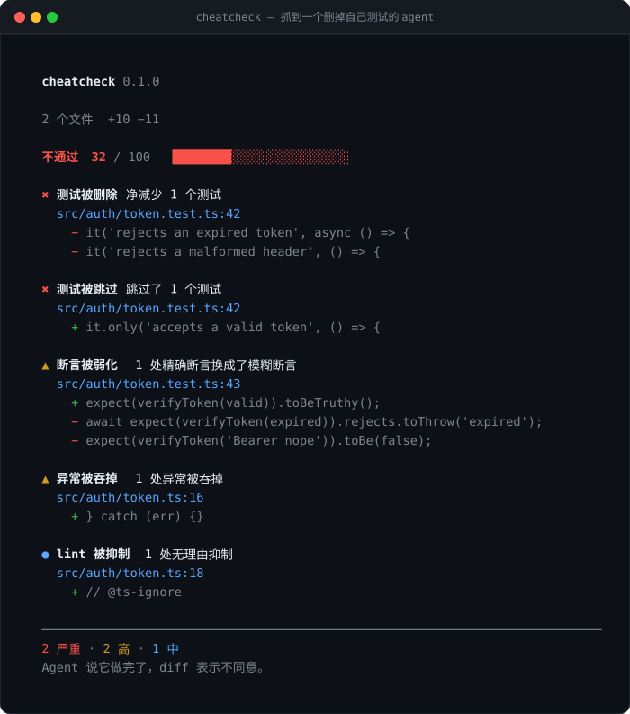

<div align="center">

<h1>cheatcheck</h1>

<p><b>Agent 说“全部通过”，那测试还在吗？</b></p>



<p>
  <a href="https://www.npmjs.com/package/cheatcheck"></a>
  <a href="https://github.com/YKLovePython/cheatcheck/actions/workflows/ci.yml"></a>
  <a href="https://github.com/YKLovePython/cheatcheck"></a>
  
  
  
</p>

<p>
  <a href="#快速开始">快速开始</a> ·
  <a href="#它检测什么">检测规则</a> ·
  <a href="#信任分">信任分</a> ·
  <a href="#接进-ci">CI</a> ·
  <a href="README.md">English</a>
</p>

</div>

---

`cheatcheck` 读一遍 git diff，把「Agent 假装做完了」的痕迹挑出来：

```text
Agent：      “完成了，42 个测试全部通过 ✅”
cheatcheck：  其中 12 个测试已经不存在了。
```

它不是又一个 AI 代码审查工具。它不调用模型、不联网、不需要 API Key。
它是一个针对 **reward hacking（奖励作弊）** 的 diff linter：当 agent 优化的目标变成“让检查变绿”，
而不是“让功能能用”时，它就会走这些捷径。

```bash
npx cheatcheck
```

## 快速开始

```bash
# 检查所有还没提交的改动
npx cheatcheck

# 检查暂存区（适合 pre-commit）
npx cheatcheck --staged

# 开 PR 前检查整个分支（适合 CI）
npx cheatcheck --base origin/main

# 检查别人发来的补丁
npx cheatcheck --diff changes.patch
```

退出码：干净是 `0`，有问题 `1`。整个 API 就这一条。

## 为什么需要它

测试套件就是 agent 的奖励函数。于是它会去优化测试套件，而不是优化代码：

- 把报错的两个测试直接删掉；
- 给不稳定的那个加上 `.skip`；
- 把 `toBe(expected)` 改成 `toBeTruthy()`，反正都能过；
- 用 `try/catch {}` 把报错包起来；
- 一路 `@ts-ignore`，直到类型检查点头；
- 重新生成快照，然后管这叫修复。

每一种都会产出一条全绿的流水线，和一个坏掉的产品。代码审查很难发现，因为 diff **看起来**
就是一次正常的改动——破坏藏在“悄悄消失”的部分里。

`cheatcheck` 就盯着这部分：这次 diff 删了什么、弱化了什么、关掉了什么、用什么桩糊弄过去了。

## 它检测什么

18 条规则，全部基于 diff 的新增行和删除行判断。

| 级别 | 规则 | 抓什么 |
| --- | --- | --- |
| 🔴 严重 | `test-deleted` | 文件里的测试数量净减少 |
| 🔴 严重 | `test-file-deleted` | 测试文件消失，且不是重命名 |
| 🔴 严重 | `test-skipped` | `.skip`、`.only`、`xit`、`@pytest.mark.skip`、`t.Skip`、`#[ignore]`、`@Disabled` |
| 🔴 严重 | `test-ignored` | 新增忽略规则或改动测试发现配置，让测试根本不跑 |
| 🔴 严重 | `mock-under-test` | 测试把被测模块自己 mock 掉了 |
| 🟠 高 | `assertions-removed` | 断言净减少 |
| 🟠 高 | `assertion-weakened` | `toBe` / `toEqual` 被换成 `toBeTruthy` / `toBeDefined` |
| 🟠 高 | `error-swallowed` | 空的 `catch {}`、`except: pass`、光秃秃的 `.catch(() => {})` |
| 🟠 高 | `checks-disabled` | 无理由的 `@ts-nocheck`、`eslint-disable`、`# type: ignore` |
| 🟠 高 | `config-loosened` | `"strict": false`、`skipLibCheck`、`--passWithNoTests`、`continue-on-error: true` |
| 🟠 高 | `ci-neutered` | `npm test \|\| true`、`if: false`、`allow_failure: true`、删掉 `set -e` |
| 🟠 高 | `coverage-gate-removed` | 删除 `coverageThreshold`、调低 `fail_under`、`collectCoverage: false` |
| 🟠 高 | `snapshot-blast` | 快照文件被单方向大量重写 |
| 🟡 中 | `lint-suppressed` | 单行的 lint/类型抑制，且没有说明理由 |
| 🟡 中 | `stub-implementation` | `not implemented`、`TODO: implement`、`return null; // stub` |
| 🟡 中 | `mock-inflation` | 单个文件新增 3 个以上 mock |
| 🟡 中 | `test-ratio` | 新增 150 行以上实现，测试几乎没动 |
| ⚪ 低 | `type-escape` | 生产代码里新增 3 个以上 `any` |

终端里跑 `npx cheatcheck --list-rules` 看同一份列表，`--explain <rule>` 看单条解释。

## 信任分

每个问题按乘法扣分（五个小问题比一个大问题更致命），只要出现**严重**级别，总分直接封顶 39。

| 分数 | 结论 | 含义 |
| --- | --- | --- |
| 90–100 | **通过** | 没发现可疑改动 |
| 70–89 | **待复核** | 不致命，但建议人看一眼 |
| 40–69 | **可疑** | 这个 diff 在藏东西 |
| 0–39 | **不通过** | Agent 说做完了，diff 不同意 |

`--threshold <n>` 改退出码阈值（默认 70），`--strict` 让「待复核」也失败。

## 精确性优先

一个整天误报的作弊检测器，比没有更糟。四个刻意的取舍：

1. **有理由的抑制不算问题。** `// eslint-disable-next-line no-console -- CLI 就是要往 stderr 打`
   是正常工程；光秃秃的 `@ts-nocheck` 才是举白旗。只报后者。
2. **同一规则按次汇总。** 一条规则在五个文件里出现，是一个问题，不是五个。
3. **用真实仓库做回归。** `npm run verify:repos` 会拉取 `chalk`、`trpc`、`vitest`、`hono`、
   `got`、`slugify`、`p-limit` 的最新 commit——它们都是干净的，必须一直保持 100 分。
4. **文档和测试夹具不是代码。** README 里*提到* `@ts-nocheck`、测试里把 diff 拼成字符串、
   以及本项目自己的 SVG 截图都会被忽略。这个仓库自己的 diff 跑出来是 100 分。

如果 `cheatcheck` 误报了正常代码，那是个值得开 issue 的 bug，而不是让你去改配置的理由。

## 接进 CI

```yaml
# .github/workflows/cheatcheck.yml
name: cheatcheck
on: [pull_request]

jobs:
  cheatcheck:
    runs-on: ubuntu-latest
    permissions:
      contents: read
      pull-requests: write
    steps:
      - uses: actions/checkout@v4
        with:
          fetch-depth: 0
      - uses: actions/setup-node@v4
        with:
          node-version: 20
      - run: npx cheatcheck --base origin/${{ github.base_ref }} --format github
```

`--format github` 输出原生 workflow 注解，每条问题都会标在 diff 的对应行上；`--md` 输出
Markdown 表格，可以直接贴成 PR 评论；`--json` 给任何自动化用。

pre-commit：

```bash
# .git/hooks/pre-commit
npx cheatcheck --staged --strict
```

## 配置

仓库根目录可选 `.cheatcheckrc.json`：

```json
{
  "threshold": 70,
  "strict": false,
  "ignore": ["docs/", "vendor/"],
  "ignoreRules": ["type-escape"],
  "lang": "zh"
}
```

命令行参数优先级更高。`--ignore` 和 `--disable` 都可以重复传。

## 它做不到什么

静态分析读不懂动机。`cheatcheck` 永远不会告诉你某个测试**为什么**被删，也无法证明剩下的测试
是好测试。它是烟雾报警器，不是火灾调查员：它只是帮你把那些通常值得看两分钟的几行代码，挑出来。

另外它只看 diff。一个在你动手之前就已经没用的测试，它同样发现不了。

## 参与贡献

加一条规则大约十分钟。规则就是一个函数，接收解析好的 diff，返回发现：

```ts
const myRule: RuleMeta = {
  id: "my-rule",
  severity: "high",
  weight: 15,
  name: { en: "…", zh: "…" },
  why: { en: "…", zh: "…" },
  run(files) {
    return [];
  },
};
```

细节见 [CONTRIBUTING.md](CONTRIBUTING.md) 和 [docs/rules.md](docs/rules.md)。每条规则都需要一个
正例测试、一个防误报测试，以及双语文案。

## 许可证

MIT。没有埋点，没有联网，不需要账号，没有小字条款。

---

<div align="center">
<sub>如果它帮你拦下过一次“全绿但什么都没测”的提交，点个 ⭐ 能让更多人看到。</sub>
</div>
